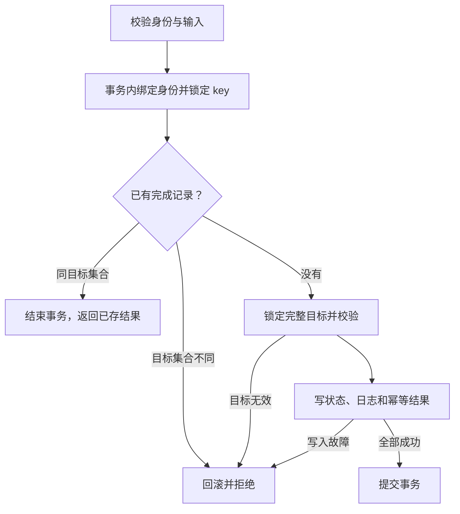

# 事务化 Action POC：审批、审计与幂等

2026-11-14，接续 PR #11。新增可运行的 Go Action 内核与独立验收，先验证业务状态、审批日志和幂等结果能否作为一个事务边界维护。**本阶段新增模型生成数为 0；尚未注册新的真实模型队列。**

## 已实现的能力

`internal/action.Executor.BulkApprove` 是一个明确的领域 Action，拥有数据库事务的开始、提交与回滚。HTTP 适配器提供新命令 `cmd/action-server`，复用原有测试身份与 guarded Purchase Runtime，并将其他接口委托给旧服务。

| 数据 | 成功时的约束 |
|---|---|
| Purchase | 完整目标集合从 submitted 变为 approved；租户、创建者和状态均符合约束 |
| ApprovalAudit | 每个目标恰好一条日志，记录租户、目标、审批人、操作、key 和前后状态 |
| ActionRequest | 每个 operation + tenant + actor + key 恰好一条已完成结果，记录规范化请求 hash 和响应 |

三者在同一 PostgreSQL 事务提交。不存在由应用提前提交的“处理中”记录；写入失败并确认回滚后，key 不被占用。



这是类型化、领域专用的内核原型。尚未实现任意 Action 的 DSL、通用工作流、外部消息投递或统一平台运行时。

## v3 契约

[机器可读契约](../benchmark/phase3/contract.json) 定义独立 v3 语义，不修改旧的 v1/v2 计划和评分：

- `POST /purchases/bulk-approve`，body 严格为 `{"ids":[...]}`；1..100 个不重复非空字符串，每个 UTF-8 长度不超过 100 字节。未知/重复字段、错误类型、无效 JSON 返回 400。
- 认证和角色先检查：匿名 401，requester 403。只有当前租户 approver 能审批他人创建的 submitted 目标。任一目标无效，完整事务拒绝，三表不变。
- HTTP body 最大 65,536 字节，超限 413；恰好边界的合法请求允许。HTTP 读取 15 秒、Action 上下文 10 秒，不承诺整体吞吐或数据库往返预算。
- 必须有一个 `Idempotency-Key`，1..128 个字符，仅允许字母、数字及 `._:-`。
- 成功 200，仅返回排序后的 `approvedIds`。首次 `Idempotency-Replayed: false`；同 key 同目标集合重放返回相同状态/响应字节，header 为 true，且三表数据和时间戳均不改变。
- 同作用域、同 key 不同集合返回 409；同集合换序视为同请求。不同 key 不得再次批准已审批记录。其他 actor 或 tenant 的相同 key 独立。
- 同 key 同集合并发请求均返回 200，只提交一次；同 key 不同集合一个成功、另一个 409；不同 key 重叠批次只能一个成功，败者独有目标不变。

哈希使用带 UTF-8 字节长度前缀的规范化集合，定义见契约；不依赖 JSON 空白或转义形式。同作用域 key 通过事务级 PostgreSQL advisory lock 串行化。锁键哈希碰撞会使无关请求额外串行，实际查询和唯一主键仍按完整作用域比较，不以锁哈希决定请求身份。

网络或提交确认丢失时，错误响应不证明事务未提交。客户端应以相同 key 重试，以读取已提交结果；本 POC 不声称实现网络级或跨系统的 exactly-once。此 key 当前没有 TTL/自动清理策略，重放保证以完成记录仍被保存为条件。

## 数据库约束与边界

Purchase 继续使用原 Policy 编译的 RLS/列权限。新增两表使用 [独立 POC SQL](../poc/transactional-action/schema.sql)：强制 RLS、非所有者运行账号、仅 SELECT/INSERT 权限；运行账号不能更新/删除已完成结果和日志。ActionRequest 限制到当前 tenant+actor，ApprovalAudit 对当前租户审批人可读。审计表以 tenant+purchase 唯一，外键绑定目标租户，并通过延迟外键绑定本事务的完成请求。

两张新表的策略是手写 SQL，**尚未接入原 Policy 编译器和语义变更审批管线**。本阶段通过直接数据库探针和启动检查验证所列边界，不把 CI 通过等同于通用策略证明。

启动时检查 Purchase 与新表的 RLS、运行角色、非所有者和追加权限。`Executor` 不向调用者暴露事务句柄，常规调用者无法提前提交。仍采用可信应用代码与固定 demo 身份；任意持有数据库凭据的恶意代码、宿主隔离、OIDC 与生产身份吊销不在已实现范围。

旧的单条审批 API 和共享 UI 仍委托原服务，尚未迁移到新 Action。因此审计/幂等保证只覆盖本新 Action，不宣称历史接口的所有审批都会生成日志。新服务是单独入口，原 `cmd/server` 与历史候选/归档不变。

## 独立验收与正反控制

Oracle 只通过 HTTP 和管理员三表快照判断结果，不调用实现中的输入校验、哈希或授权函数。快照核对所有原字段和新增元数据，拒绝和重放必须保持已有记录/时间戳不变。未预期的验收器/RPC 异常使整轮执行失败，不能作为成功发现负控制。

| 评分组 | 用例数 |
|---|---:|
| 授权功能 | 6 |
| 身份/行授权 | 5 |
| 混合目标整批原子性 | 4 |
| 输入与容量边界 | 24 |
| 幂等重放、冲突与作用域 | 6 |
| 并发 | 3 |
| 写入故障回滚及同 key 恢复重试 | 2 |
| 原有 API 回归 | 16 |
| 合计 | **66** |

故障通过管理员安装数据库 trigger 注入：一个让 ApprovalAudit INSERT 失败，另一个让 ActionRequest INSERT 失败。两种情形都发生在审批 UPDATE 之后，后者也发生在审计写入之后。要求返回 503、三表完全不变；移除故障后必须以同 key 成功重试。这里的 503 是明确的故障注入控制，不能当成普通功能成功或权限拦截。

| 人工控制 | 应观察到的差异 |
|---|---|
| reference | **66/66** |
| omit-audit | 无日志，授权业务完整性失败 |
| commit-before-audit | 普通功能可通过，数据库写入故障后留下已审批状态 |
| skip-replay | 普通功能可通过，相同 key 重放或并发重放不满足契约 |
| skip-completeness | 普通功能可通过，混合批次部分提交 |
| reject-all | 无法完成授权业务操作 |

六次实际服务运行、每次 66 项检查，参考全部通过，五个负控制均被识别。另有 **10 项直接 SQL 探针**（无上下文/跨租户读取、追加权限、伪造插入）及 **5 项启动探针**（Purchase/Audit 未启用 RLS、完成结果可修改、未授权启用负控制、未知负控制）。

负控制开关仅在显式 `POC_ALLOW_MUTATIONS=1` 时允许，不能通过 HTTP 请求选择。它们是人工故障，不是模型输出。源码 hash、本地环境与分组结果见 [机制证据](evidence/transactional-action-2026-11-14/controls.json)。CI 会在 PostgreSQL 17.6 再运行全部控制，不调用模型。

## 运行与复现

按 README 准备 Go、Node/pg、Python、可销毁 `_poc` 数据库及两个数据库 URL，显式设置 `POC_DB_RESET=1`。初始化会重建本 POC 的三张表：

```bash
printf '%s\n' '{"op":"init"}' | node benchmark/phase3/db.mjs
go run ./cmd/action-server
```

新终端：

```bash
curl -i -X POST http://127.0.0.1:8080/purchases/bulk-approve \
  -H 'Authorization: Bearer demo_carol' \
  -H 'Content-Type: application/json' -H 'Idempotency-Key: demo-001' \
  --data '{"ids":["a-own","a-other"]}'
# 原样再次请求：同响应，Idempotency-Replayed: true
```

服务仅监听 loopback；`POC_HTTP_PORT` 可更换端口。运行全部机制控制前停止手动服务，数据库/端口不能并发共用：

```bash
python3 benchmark/phase3/smoke.py
```

输出在 `reports/action-controls/`。已有输出拒绝覆盖，可用 `--out reports/action-controls-another`。脚本只将运行时 URL 交给服务，管理员 URL 只供独立 fixture/快照/故障 helper 使用；临时编译二进制运行结束后删除。认证文件不参与本阶段。

## 下一轮模型试验的准备状态

本 PR 提供了可调用内核、明确 v3 契约和已验证的评分控制，尚未提供新的 cohort plan/driver 或模型效果数据。下一轮可以比较“手写事务逻辑”和“调用平台 Action”完成相同业务演进的结果，但应采用同一个固定基础候选，而不是把四个不同的旧生成实现分别作为起点。

启动前仍需：冻结统一起点、两种条件的能力/源码白名单、完整相同业务要求、可见测试服务、参数和预算；将生成与私有验收隔离；明确是否同时估计额外流程指导。v2 执行器不会自动识别本 v3 契约，不能直接用旧计划冒充新实验。人工控制结果不能估计 AI 缺陷率或成本收益。
